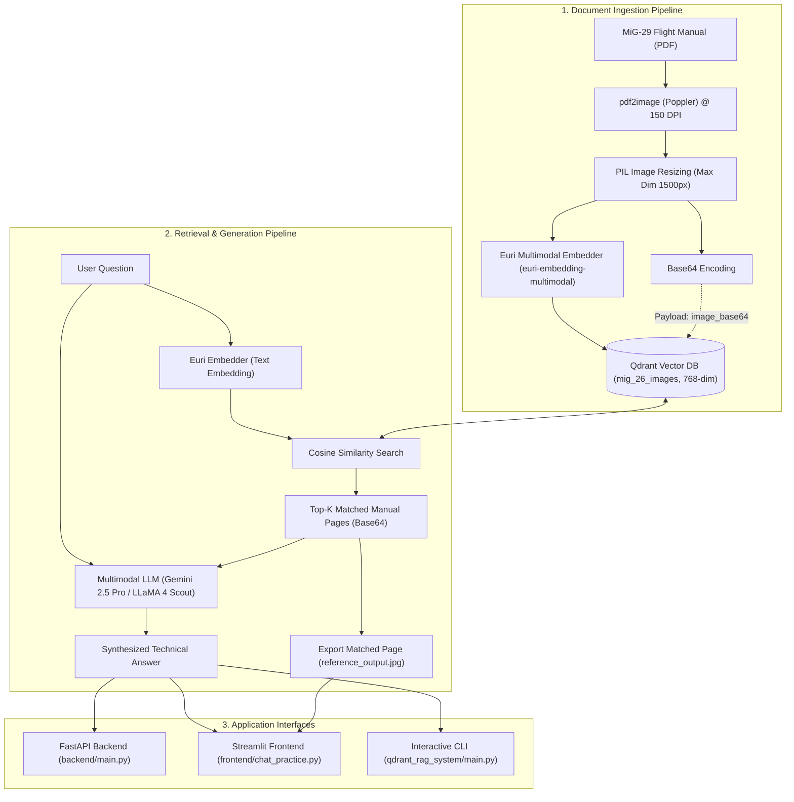

# ✈️ AeroRAG Intelligence Application

> **A Multimodal Retrieval-Augmented Generation (RAG) System for Aerospace Engineering & Technical Flight Manuals**

[](https://www.python.org/downloads/)
[](https://fastapi.tiangolo.com)
[](https://streamlit.io)
[](https://qdrant.tech)
[](https://www.langchain.com)
[](LICENSE)

---

## 📖 Table of Contents

- [Overview](#-overview)
- [Why Multimodal RAG for Aerospace Manuals?](#-why-multimodal-rag-for-aerospace-manuals)
- [System Architecture](#-system-architecture)
- [Repository Structure](#-repository-structure)
- [Prerequisites](#-prerequisites)
- [Installation & Environment Setup](#-installation--environment-setup)
- [Running the System](#-running-the-system)
  - [1. Start Qdrant Vector Database](#1-start-qdrant-vector-database)
  - [2. Run Ingestion & Interactive CLI RAG](#2-run-ingestion--interactive-cli-rag)
  - [3. Start the FastAPI Backend](#3-start-the-fastapi-backend)
  - [4. Test the API](#4-test-the-api)
  - [5. Launch the Streamlit Frontend](#5-launch-the-streamlit-frontend)
- [REST API Reference](#-rest-api-reference)
- [Core Components Breakdown](#-core-components-breakdown)
  - [Document Ingestion (`document_processor.py`)](#document-ingestion-document_processorpy)
  - [Multimodal Embedder (`embedder.py`)](#multimodal-embedder-embedderpy)
  - [Vector Database Manager (`qdrant_manager.py`)](#vector-database-manager-qdrant_managerpy)
  - [Vision LLM Reasoning (`gemini_rag_llm.py` & `groq_rag_llm.py`)](#vision-llm-reasoning-gemini_rag_llmpy--groq_rag_llmpy)
- [Troubleshooting & FAQs](#-troubleshooting--faqs)
- [Development Roadmap](#-development-roadmap)

---

## 🌟 Overview

**AeroRAG Intelligence** is an end-to-end, vision-first Retrieval-Augmented Generation (RAG) platform designed specifically for dense aerospace engineering documentation and flight operations manuals (demonstrated using the **MiG-29 Flight Operations Manual Part 1**).

Rather than stripping away formatting and ignoring rich visual elements via traditional text chunking, AeroRAG ingests technical manuals at the **page level as high-resolution images**, creates **joint visual-text vector embeddings**, and retrieves original visual pages directly into state-of-the-art vision-language models (e.g., **Gemini 2.5 Pro** or **LLaMA 4 Scout**). 

The system pairs synthesized textual answers directly with the **exact visual reference page** from the manual, giving aerospace engineers, maintenance technicians, and flight crews verifiable visual proof for every query.

---

## 🎯 Why Multimodal RAG for Aerospace Manuals?

Traditional text-only RAG pipelines fail when deployed against aeronautical documentation because:

| Traditional Text-Only RAG ❌ | AeroRAG Multimodal Vision RAG ✅ |
| :--- | :--- |
| Drops complex schematics, cockpit instrument panels, wiring diagrams, and hydraulic flows. | Ingests each page as a rendered image, preserving all layouts, fonts, indicators, and schematics. |
| Tables and performance envelopes lose spatial column alignments during raw text extraction. | Vision models inspect tables, curves, and graphs natively with full spatial awareness. |
| Cannot answer questions referencing visual components (e.g., switch positions, gauge colors, warning lights). | Can inspect labels, dials, switch positions, and warning lights directly from cockpit layout images. |
| Citations are text snippets with no visual verification. | Outputs the exact page graphic (`reference_output.jpg`) alongside the answer for auditability. |

---

## 🏗️ System Architecture

The application is structured into two primary pipelines:

1. **Ingestion Pipeline**: Converts PDF pages into images, resizes them, extracts multimodal embeddings, and indexes them into Qdrant.
2. **Inference Pipeline**: Embeds user queries, conducts vector cosine search against page embeddings, retrieves top-k matching manual pages, passes them to a Vision-Language Model, and outputs both an answer and visual citation.



---

## 📂 Repository Structure

```text
AeroRAG_Intelligence_Application/
├── .env                              # Local environment variables & API keys (gitignored)
├── .env.example                      # Template for required environment variables
├── pyproject.toml                    # Project dependencies and packaging metadata
├── uv.lock                           # Locked dependency graph
├── start_qdrant.sh                   # Shell script to start Qdrant container with Docker
├── main.py                           # Root entry point
├── test_api.py                       # Automated test script for FastAPI endpoints
├── README.md                         # Project documentation
│
├── backend/                          # FastAPI Backend Application
│   ├── __init__.py
│   ├── main.py                       # FastAPI routes, CORS configuration, health checks
│   └── schemas/                      # Pydantic data schemas
│       ├── __init__.py
│       ├── request.py                # AskRequest model (validation rules)
│       └── response.py               # AskResponse model
│
├── frontend/                         # Streamlit Interactive Web Applications
│   ├── chat_practice.py              # Interactive chat UI with conversation history & state
│   ├── practice_app.py               # Dual-column dashboard with visual manual viewer
│   └── session_practice.py           # Streamlit session state testing script
│
├── pdfs/                             # Source Technical Documentation
│   └── MIG29-Flight-Manual-Pt-1.pdf  # MiG-29 Flight Operations Manual (Part 1)
│
├── qdrant_rag_system/                # Core Multimodal RAG Engine
│   ├── __init__.py
│   ├── main.py                       # End-to-end ingestion and interactive CLI search
│   ├── document_processor.py         # PDF-to-image conversion & PIL Base64 utilities
│   ├── embedder.py                   # Euri multimodal image & text vector embedder
│   ├── qdrant_manager.py             # Qdrant client, collection creation, indexing & search
│   ├── gemini_rag_llm.py             # Gemini 2.5 Pro vision generation via LangChain/OpenAI
│   ├── groq_rag_llm.py               # Alternative Groq vision LLM (LLaMA-4 Scout)
│   ├── reference_output.jpg          # Most recently retrieved manual page image
│   └── requirements.txt              # Direct pip requirements for RAG module
│
└── qdrant_storage/                   # Persistent storage for Qdrant (Docker bind / local path)
    ├── aliases/
    ├── collections/
    │   └── mig_26_images/            # Pre-indexed collection vectors and payloads
    └── raft_state.json
```

---

## ⚙️ Prerequisites

Before installing, ensure your environment meets the following requirements:

1. **Python 3.12+**
2. **Poppler** (Required by `pdf2image` for rendering PDF pages into images):
   - **Windows**:
     ```powershell
     winget install -e --id OSGeo.Poppler
     # OR using Chocolatey:
     choco install poppler
     ```
     *Ensure `poppler/bin` is added to your system `PATH`.*
   - **macOS**:
     ```bash
     brew install poppler
     ```
   - **Linux (Ubuntu/Debian)**:
     ```bash
     sudo apt-get update && sudo apt-get install -y poppler-utils
     ```
3. **Docker** (Recommended for hosting the Qdrant vector database).
4. **API Keys**:
   - `EURI_API_KEY`: API key for Euron endpoint (multimodal embeddings and Gemini 2.5 Pro).
   - `GROQ_API_KEY`: (Optional) API key for Groq vision models.

---

## 🚀 Installation & Environment Setup

### 1. Clone the Repository
```bash
git clone https://github.com/your-username/AeroRAG_Intelligence_Application.git
cd AeroRAG_Intelligence_Application
```

### 2. Create and Activate Virtual Environment

Using standard Python `venv`:
```bash
# Windows (PowerShell)
python -m venv .venv
.venv\Scripts\Activate.ps1

# Linux / macOS
python3 -m venv .venv
source .venv/bin/activate
```

Or using [`uv`](https://github.com/astral-sh/uv) (recommended for faster installs):
```bash
uv venv
# On Windows:
.venv\Scripts\activate
# On Linux/macOS:
source .venv/bin/activate
```

### 3. Install Dependencies

Install all dependencies declared in `pyproject.toml`:
```bash
pip install -e .
```
Or with `uv`:
```bash
uv pip install -e .
```

### 4. Configure Environment Variables

Copy the template file to `.env`:
```bash
cp .env.example .env
```
Open `.env` and configure your credentials:
```env
# Euri API Key for multimodal embeddings and Gemini LLM
EURI_API_KEY="your_euri_api_key_here"

# Groq API Key (if using Groq Vision)
GROQ_API_KEY="your_groq_api_key_here"

# Vector DB Settings
QDRANT_HOST="localhost"
QDRANT_PORT=6333
QDRANT_COLLECTION_NAME="mig_26_images"
```

---

## 🏃 Running the System

Follow these steps to run each layer of the AeroRAG application:

### 1. Start Qdrant Vector Database

#### Option A: Using the Docker Script (Recommended)
On Linux/macOS or Git Bash for Windows:
```bash
bash start_qdrant.sh
```

#### Option B: Using Docker CLI directly
```bash
docker run -d \
  --name qdrant \
  -p 6333:6333 \
  -p 6334:6334 \
  -v "${PWD}/qdrant_storage:/qdrant/storage" \
  qdrant/qdrant
```

#### Option C: Automatic Local Storage Fallback
If Docker is not running on your machine, `QdrantManager` automatically detects this and falls back to the embedded local disk storage in `./qdrant_storage`.

> **Qdrant Dashboard**: When the Docker container is active, open your browser to inspect collections and vectors:
> [http://localhost:6333/dashboard](http://localhost:6333/dashboard)

---

### 2. Run Ingestion & Interactive CLI RAG

Execute the standalone RAG pipeline:
```bash
python qdrant_rag_system/main.py
```

**What this script does:**
1. Verifies connectivity to Qdrant (Docker server at `localhost:6333` or local fallback `./qdrant_storage`).
2. Checks if the `mig_26_images` collection exists. If empty:
   - Converts `pdfs/MIG29-Flight-Manual-Pt-1.pdf` pages into high-res images.
   - Computes multimodal vectors via `euri-embedding-multimodal`.
   - Inserts embeddings and Base64 payloads into Qdrant in batches.
3. Launches an interactive question-answering CLI loop.
4. Saves the most relevant manual page image retrieved for each question as `reference_output.jpg`.

Example CLI run:
```text
Successfully connected to Qdrant server running on Docker (localhost:6333)
Vectors already present in Qdrant database. Skipping document ingestion.

==================================================
Qdrant RAG system is ready!
Type your question below. Type 'exit' or 'quit' to stop.
==================================================

Ask a question: What is the primary function of the radar system?
Embedding query text...
Retrieving most relevant image from Qdrant...
Sending request to Gemini LLM ...

==================================================
Answer:
The radar system is designed for target detection, tracking, and weapons guidance
in both air-to-air and air-to-surface combat regimes. It feeds target coordinates
directly to the Head-Up Display (HUD) and weapon release computers.
==================================================

Saved the matched reference image to 'reference_output.jpg'.
```

---

### 3. Start the FastAPI Backend

Run the backend REST API server using Uvicorn:
```bash
uvicorn backend.main:app --reload --host 127.0.0.1 --port 8000
```

- API Base URL: `http://127.0.0.1:8000`
- Interactive Swagger UI: `http://127.0.0.1:8000/docs`
- ReDoc Documentation: `http://127.0.0.1:8000/redoc`

---

### 4. Test the API

To verify that the API is responding correctly, run the provided automated test script:
```bash
python test_api.py
```

Expected output:
```text
Status Code: 200
Response: {'question': 'What is the purpose of the radar?', 'answer': 'You asked: What is the purpose of the radar?'}
```

Or test with `curl`:
```bash
curl -X POST "http://127.0.0.1:8000/ask" \
     -H "Content-Type: application/json" \
     -d '{"question": "Explain the emergency engine restart procedure."}'
```

---

### 5. Launch the Streamlit Frontend

#### Chat Application (`frontend/chat_practice.py`)
Provides an interactive chat interface with session history and error logging:
```bash
streamlit run frontend/chat_practice.py
```

#### Manual Inspection Dashboard (`frontend/practice_app.py`)
Provides a dual-column layout with answer display and manual page image viewer:
```bash
streamlit run frontend/practice_app.py
```

The Streamlit UI will open automatically at:
[http://localhost:8501](http://localhost:8501)

---

## 📡 REST API Reference

The backend is built with FastAPI and enforces schema validation using Pydantic.

### Endpoints Overview

| Method | Endpoint | Description | Request Body | Response Body |
| :--- | :--- | :--- | :--- | :--- |
| `GET` | `/` | Root endpoint welcoming clients | *None* | `{"message": "..."}` |
| `GET` | `/health` | Service health status | *None* | `{"status": "healthy"}` |
| `POST` | `/ask` | Ask a question about the flight manual | `AskRequest` | `AskResponse` |
| `GET` | `/test-error` | Simulates an upstream 503 error | *None* | `{"detail": "..."}` |

### Schemas

#### `AskRequest` (`backend/schemas/request.py`)
```json
{
  "question": "What are the limitations on maximum airspeed at low altitude?"
}
```
- `question` (string, required): The query string. Validated with `min_length=3`.

#### `AskResponse` (`backend/schemas/response.py`)
```json
{
  "question": "What are the limitations on maximum airspeed at low altitude?",
  "answer": "Maximum indicated airspeed at low altitude is limited to..."
}
```

---

## 🔬 Core Components Breakdown

### Document Ingestion (`document_processor.py`)
- **`pdf_to_images(pdf_path)`**: Converts the PDF into PIL images at 150 DPI via `pdf2image`. Automatically calculates aspect ratio and constrains the maximum dimension to 1500 pixels using `Image.Resampling.LANCZOS`. This prevents token overflows when transmitting images to vision APIs.
- **`image_to_base64(image)`**: Serializes PIL images to Base64 encoded JPEG strings for storage in Qdrant payloads and HTTP transport.

### Multimodal Embedder (`embedder.py`)
- **`EuriEmbedder`**: Connects to the Euron API gateway using the OpenAI-compatible Python SDK.
- **`embed_image(image)`**: Encodes images into a 768-dimensional multimodal vector representation using the `euri-embedding-multimodal` model.
- **`embed_text(text)`**: Encodes textual user questions into the **exact same 768-dimensional latent space**, enabling direct cosine similarity comparisons between words and pictures.

### Vector Database Manager (`qdrant_manager.py`)
- **`QdrantManager`**: Manages connections, collection creation, batch uploads, and querying.
- **Dimension Check**: Dynamically verifies whether an existing collection's vector dimensions match the embedder (e.g., 768). If a mismatch occurs, it safely recreates the collection.
- **Batch Insertion**: Inserts embeddings and full Base64 page images in batches of 5 with UUID point IDs.
- **Similarity Search**: Performs cosine similarity search (`query_points`) and returns top-k Base64 page images.

### Vision LLM Reasoning (`gemini_rag_llm.py` & `groq_rag_llm.py`)
- **`GeminiRAG`**: Employs LangChain's `ChatOpenAI` wrapper pointing to `gemini-2.5-pro` via the Euron endpoint. It builds a structured message containing the system instructions, user question, and `image_url` payload containing the retrieved manual page.
- **`GroqRAG`**: Alternative implementation using the native `groq` SDK with vision model `meta-llama/llama-4-scout-17b-16e-instruct`.

---

## 🛠️ Troubleshooting & FAQs

### 1. `pdf2image.exceptions.PDFInfoNotInstalledError`
**Cause**: Poppler is not installed or its `bin` directory is not in your system `PATH`.  
**Solution**:
- On Windows: Run `winget install -e --id OSGeo.Poppler`, locate the install folder (e.g., `C:\Program Files\poppler\bin`), and add it to your system Environment Variables under `PATH`. Restart your terminal.
- On Ubuntu/Debian: `sudo apt-get install -y poppler-utils`
- On macOS: `brew install poppler`

### 2. `ValueError: EURI_API_KEY environment variable not set.`
**Cause**: The `.env` file is missing or `EURI_API_KEY` has not been provided.  
**Solution**: Copy `.env.example` to `.env` and fill in your valid API key. Ensure `load_dotenv()` can locate the file.

### 3. Qdrant Connection Refused on `localhost:6333`
**Cause**: The Qdrant Docker container is stopped.  
**Solution**: Run `bash start_qdrant.sh` or `docker start qdrant`. Note that `qdrant_rag_system/main.py` will automatically fall back to local disk storage (`qdrant_storage/`) if Docker is unavailable.

### 4. Vector Dimension Mismatch
**Cause**: An existing collection was created with a different embedding model dimension (e.g., 1536 instead of 768).  
**Solution**: `QdrantManager.ensure_collection()` will detect this automatically, output a warning, delete the stale collection, and recreate it with the correct dimension.

---

## 🗺️ Development Roadmap

- [x] Multimodal page-level ingestion for PDF flight manuals.
- [x] Joint image-text embedding with Euri multimodal models.
- [x] Qdrant vector storage with dual mode (Docker & local path fallback).
- [x] Vision-language reasoning with Gemini 2.5 Pro & Groq LLaMA 4 Scout.
- [x] FastAPI backend boilerplate with CORS and schema validation.
- [x] Streamlit chat UI and manual inspection views.
- [ ] Connect FastAPI `/ask` route directly to `QdrantManager` and `GeminiRAG` pipeline.
- [ ] Multi-page retrieval (top-k > 1) with reranking based on diagram proximity.
- [ ] Visual bounding box highlighting to highlight exact switches or dials mentioned in the answer.
- [ ] Multi-manual document ingestion endpoint (`POST /upload`).

---

## 📄 License

This project is licensed under the MIT License. See the [LICENSE](LICENSE) file for details.
